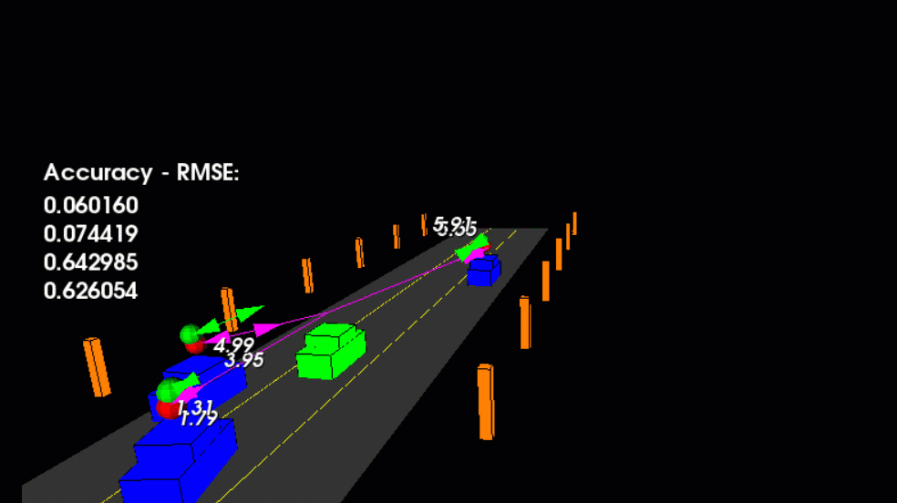

# UKF LiDAR–Radar Fusion Tracking

An Unscented Kalman Filter in C++ that tracks three cars on a simulated
highway by fusing noisy lidar and radar measurements. Each car has its own
filter with a CTRV (constant turn rate and velocity) motion model; lidar
updates are linear, radar updates (range, bearing, range rate) go through
the unscented transform.



The ego car (green) drives in the centre lane; the traffic cars (blue)
accelerate, brake and change lanes. Red spheres are lidar detections, purple
lines are radar detections with their range rate, and green spheres and
arrows are the UKF estimates of position and velocity.

## Results

RMSE over the 10 s run, against targets checked continuously after the first
second:

| | px [m] | py [m] | vx [m/s] | vy [m/s] |
|---|---|---|---|---|
| Target | 0.30 | 0.16 | 0.95 | 0.70 |
| **UKF** | **0.068** | **0.080** | **0.433** | **0.477** |

How the filter works and how it was tuned: [docs/DESIGN.md](docs/DESIGN.md).

## Build and run

Ubuntu 22.04 or 24.04:

```bash
sudo apt install cmake g++ libeigen3-dev libpcl-dev
cmake -S . -B build && cmake --build build -j
./build/highway_ukf
```

The program prints the final RMSE and exits with status 0 when every target
was met.

## Options

In [src/sim/highway.h](src/sim/highway.h):

- `trackCars`: which traffic cars to track
- `visualize_lidar`, `visualize_radar`: draw the measurements
- `visualize_pcd`: draw the recorded lidar point clouds (`data/pcd`) instead of the car models
- `projectedTime`, `projectedSteps`: draw each UKF's predicted path

## Layout

```
src/ukf.h, ukf.cpp     the filter
src/measurement.h      sensor reading passed to the filter
src/sim/               highway scene, sensor simulation, ray-cast lidar
src/render/            PCL drawing
data/pcd/              recorded lidar point clouds of the scene
docs/                  design notes and images
```

## Credits

The highway scene, rendering and recorded point clouds are adapted from
Aaron Brown's highway UKF simulation.
